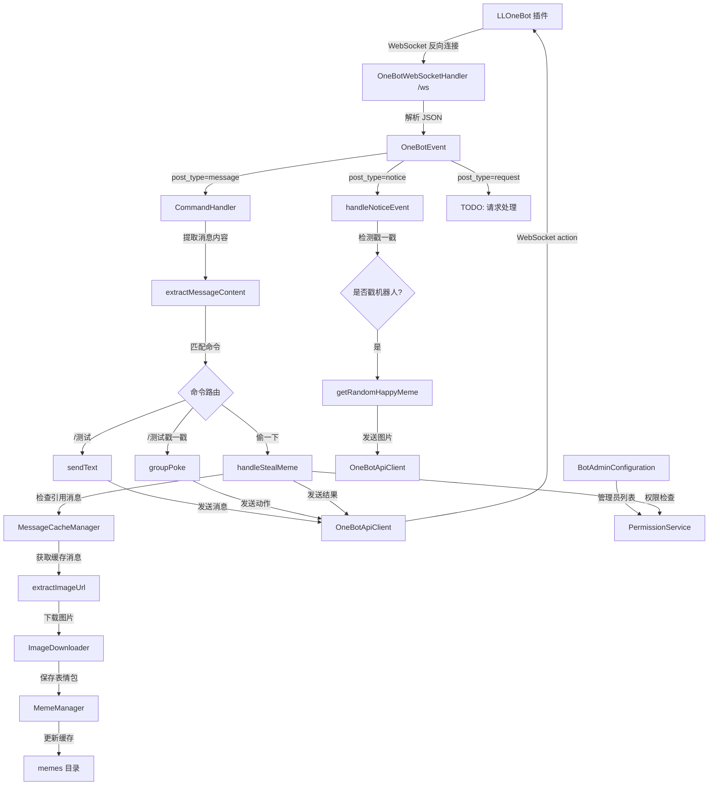

# J-One 项目结构图

## 1. 项目概述

J-One 是一个基于 Spring Boot 的 QQ 机器人项目，使用 OneBot v11 协议与 LLOneBot 插件进行通信。项目采用 WebSocket 反向连接方式接收消息事件，并通过 WebSocket 发送指令控制 QQ 客户端。

## 2. 技术栈

- **Java**: 11
- **Spring Boot**: 2.6.13
- **WebSocket**: spring-boot-starter-websocket
- **JSON处理**: fastjson2 2.0.40
- **Lombok**: 简化代码
- **OneBot v11**: QQ 机器人协议

## 3. 项目目录结构

```
src/main/java/com/bot/jone/
├── JOneApplication.java          # 主启动类
├── client/
│   └── OneBotApiClient.java      # OneBot API 客户端（发送指令）
├── config/
│   ├── BotAdminConfiguration.java # 管理员配置类
│   └── WebSocketConfig.java       # WebSocket 配置类
├── handler/
│   ├── CommandHandler.java        # 命令处理器（消息业务逻辑）
│   ├── MessageCacheManager.java   # 消息缓存管理器
│   └── OneBotWebSocketHandler.java # WebSocket 消息接收处理器
├── ioutils/
│   ├── ImageDownloader.java       # 图片下载工具
│   ├── MemeManager.java           # 表情包管理器
│   └── memes/                     # 表情包文件目录
│       ├── happy/                 # 开心表情分类
│       ├── sad/                   # 悲伤表情分类
│       ├── confused/              # 困惑表情分类
│       └── ...                    # 其他表情分类
├── model/
│   └── OneBotEvent.java           # OneBot 事件模型
└── permission/
    └── PermissionService.java     # 权限服务
```

## 4. 各包功能详解

### 4.1 `com.bot.jone` (根包)

**文件**: [JOneApplication.java](file://D:\Code\QQBot\my-j-one\J-One\src\main\java\com\bot\jone\JOneApplication.java)

**功能**: 
- Spring Boot 应用主启动类
- 包含 `main` 方法，启动整个应用

**使用方式**:
```java
@SpringBootApplication
public class JOneApplication {
    public static void main(String[] args) {
        SpringApplication.run(JOneApplication.class, args);
    }
}
```

---

### 4.2 `com.bot.jone.client` (API 客户端层)

**文件**: [OneBotApiClient.java](file://D:\Code\QQBot\my-j-one\J-One\src\main\java\com\bot\jone\client\OneBotApiClient.java)

**功能**:
- 封装 OneBot API 调用
- 通过 WebSocket 向 QQ 客户端发送指令（action）
- 支持发送文本、图片、戳一戳等操作

**主要方法**:
- `sendText()`: 发送文本消息
- `sendImage()`: 发送图片消息
- `groupPoke()`: 群聊戳一戳
- `getMessage()`: 获取消息详情（扩展 API）

**使用示例**:
```java
@Autowired
private OneBotApiClient apiClient;

// 发送文本
apiClient.sendText(session, "group", groupId, "你好");

// 发送图片
apiClient.sendImage(session, "group", groupId, "/path/to/image.jpg");

// 戳一戳
apiClient.groupPoke(session, groupId, userId);
```

---

### 4.3 `com.bot.jone.config` (配置层)

#### 4.3.1 [WebSocketConfig.java](file://D:\Code\QQBot\my-j-one\J-One\src\main\java\com\bot\jone\config\WebSocketConfig.java)

**功能**:
- 配置 WebSocket ServerEndpointExporter
- 自动注册使用了 `@ServerEndpoint` 注解的端点

**配置内容**:
```java
@Configuration
public class WebSocketConfig {
    @Bean
    public ServerEndpointExporter serverEndpointExporter() {
        return new ServerEndpointExporter();
    }
}
```

#### 4.3.2 [BotAdminConfiguration.java](file://D:\Code\QQBot\my-j-one\J-One\src\main\java\com\bot\jone\config\BotAdminConfiguration.java)

**功能**:
- 读取配置文件中的管理员 QQ 号列表
- 使用 `@ConfigurationProperties` 绑定 `bot.admin.qq-list` 配置

**配置映射**:
```yaml
bot:
  admin:
    qq-list:
      - 1948259961
      - 其他管理员QQ
```

**使用方式**:
```java
@Autowired
private BotAdminConfiguration adminConfig;

List<Long> admins = adminConfig.getQqList();
```

---

### 4.4 `com.bot.jone.handler` (处理器层 - 核心业务逻辑)

#### 4.4.1 [OneBotWebSocketHandler.java](file://D:\Code\QQBot\my-j-one\J-One\src\main\java\com\bot\jone\handler\OneBotWebSocketHandler.java)

**功能**:
- WebSocket 服务端点 (`@ServerEndpoint("/ws")`)
- 接收来自 LLOneBot 的所有事件推送
- 根据 `post_type` 分发到不同处理器：
  - `message`: 消息事件 → CommandHandler
  - `notice`: 通知事件（如戳一戳）→ 内部处理
  - `request`: 请求事件（好友申请等）→ TODO

**工作流程**:
```
LLOneBot → WebSocket (/ws) → OneBotWebSocketHandler
                                    ↓
                          解析 JSON → OneBotEvent
                                    ↓
                    根据 post_type 分发到不同处理器
```

**特殊功能**:
- 消息缓存：收到消息时自动缓存到 MessageCacheManager
- 戳一戳响应：当机器人被戳时，随机发送 happy 表情

#### 4.4.2 [CommandHandler.java](file://D:\Code\QQBot\my-j-one\J-One\src\main\java\com\bot\jone\handler\CommandHandler.java)

**功能**:
- 处理消息事件的业务逻辑
- 解析消息内容（支持文本、图片、@、表情等多种类型）
- 实现具体命令：
  - `/测试`: 测试回复
  - `/测试戳一戳`: 触发戳一戳
  - `偷一下`: 偷表情包（支持引用消息）

**消息提取**:
```java
// 支持多种消息类型的提取
- text: 文本消息
- image: 图片消息（提取 URL）
- face: QQ 表情
- at: @某人
- reply: 引用消息（提取 message_id）
- record: 语音
- video: 视频
- share: 分享链接
```

**偷图功能流程**:
```
用户发送"偷一下" 
    ↓
检查是否有引用消息
    ↓
从缓存中获取被引用消息
    ↓
提取图片 URL
    ↓
下载图片 → ImageDownloader
    ↓
保存到表情包目录 → MemeManager
    ↓
发送成功提示
```

#### 4.4.3 [MessageCacheManager.java](file://D:\Code\QQBot\my-j-one\J-One\src\main\java\com\bot\jone\handler\MessageCacheManager.java)

**功能**:
- 缓存最近收到的图片消息（最多 100 条）
- 支持按 message_id 查询
- 记录每个群最后一条图片消息
- 用于"偷一下"功能的引用消息场景

**缓存策略**:
- 只缓存包含图片的消息
- 使用 `ConcurrentHashMap` 保证线程安全
- 超过最大容量时删除最早的消息

**主要方法**:
```java
cacheMessage(JSONObject eventJson)        // 缓存消息
getCachedMessage(Integer messageId)       // 根据 ID 获取
getLastImageMessage(Long groupId)         // 获取群内最后图片消息
clearCache()                              // 清理缓存
```

---

### 4.5 `com.bot.jone.ioutils` (IO 工具层)

#### 4.5.1 [MemeManager.java](file://D:\Code\QQBot\my-j-one\J-One\src\main\java\com\bot\jone\ioutils\MemeManager.java)

**功能**:
- 管理表情包文件
- 启动时预加载所有表情文件到内存缓存
- 支持按分类获取随机表情
- 支持保存新表情包到指定分类

**表情包目录结构**:
```
memes/
├── happy/          # 开心表情
├── sad/            # 悲伤表情
├── confused/       # 困惑表情
├── angry/          # 生气表情
├── shy/            # 害羞表情
├── sleep/          # 睡觉表情
├── meow/           # 喵表情
├── like/           # 喜欢表情
├── fool/           # 愚弄表情
├── morning/        # 早安表情
├── sigh/           # 叹气表情
├── surprised/      # 惊讶表情
├── work/           # 工作表情
├── color/          # 彩色表情
├── see/            # 看看表情
├── baka/           # 笨蛋表情
├── reply/          # 回复表情
├── givemoney/      # 给钱表情
└── 旮旯给木表情包/  # 特殊分类（用于戳一戳和偷图）
```

**主要方法**:
```java
getRandomMeme(String category)          // 获取指定分类随机表情
getRandomMemeFromAll()                  // 从所有分类随机获取
getRandomHappyMeme()                    // 获取旮旯给木随机表情
saveMeme(byte[], category, name, ext)   // 保存新表情包
refreshAllCache()                       // 刷新缓存
```

**安全特性**:
- 防止路径穿越攻击（检查 `..`、`/`、`\`）
- 验证文件扩展名合法性
- 确保文件保存在预期目录下

#### 4.5.2 [ImageDownloader.java](file://D:\Code\QQBot\my-j-one\J-One\src\main\java\com\bot\jone\ioutils\ImageDownloader.java)

**功能**:
- 从 URL 下载图片
- 提取文件扩展名
- 模拟浏览器请求头（User-Agent）

**主要方法**:
```java
downloadImage(String imageUrl)          // 下载图片返回字节数组
extractExtension(String imageUrl)       // 从 URL 提取扩展名
```

**使用示例**:
```java
byte[] imageData = imageDownloader.downloadImage("https://example.com/image.jpg");
String ext = imageDownloader.extractExtension(imageUrl); // 返回 "jpg"
```

---

### 4.6 `com.bot.jone.model` (模型层)

**文件**: [OneBotEvent.java](file://D:\Code\QQBot\my-j-one\J-One\src\main\java\com\bot\jone\model\OneBotEvent.java)

**功能**:
- OneBot 事件的数据模型
- 使用 Lombok `@Data` 自动生成 getter/setter
- 使用 `@JSONField` 注解映射 JSON 字段（snake_case → camelCase）

**主要字段**:
```java
// 通用字段
selfId          // 机器人 QQ 号
userId          // 发送者 QQ 号
postType        // 事件类型: message/notice/request

// 消息事件字段
messageId       // 消息 ID
messageType     // 消息类型: group/private
message         // 消息数组（JSONArray）
sender          // 发送者信息（内部类）
groupId         // 群号

// 通知事件字段
noticeType      // 通知类型: notify/group_upload 等
targetId        // 目标 ID（如被戳的用户）

// 请求事件字段
requestType     // 请求类型: friend/group
comment         // 验证信息
flag            // 请求标识
```

**Sender 内部类**:
```java
@Data
public static class Sender {
    Long userId;        // 发送者 QQ
    String nickname;    // 昵称
    String card;        // 群名片
    String role;        // 群角色: owner/admin/member
    String level;       // 群等级
    String title;       // 专属头衔
}
```

---

### 4.7 `com.bot.jone.permission` (权限层)

**文件**: [PermissionService.java](file://D:\Code\QQBot\my-j-one\J-One\src\main\java\com\bot\jone\permission\PermissionService.java)

**功能**:
- 权限验证服务
- 判断用户是否为管理员
- 启动时加载管理员列表到 HashSet（提高查询性能）

**主要方法**:
```java
isAdmin(long userId)    // 判断是否为管理员
```

**使用示例**:
```java
@Autowired
private PermissionService permissionService;

if (permissionService.isAdmin(userId)) {
    // 执行管理员操作
} else {
    // 拒绝访问
}
```

---

## 5. 数据流向图



## 6. 核心流程说明

### 6.1 消息接收流程

1. **LLOneBot** 通过 WebSocket 反向连接到 `ws://localhost:9026/ws`
2. **OneBotWebSocketHandler** 接收消息 JSON
3. 解析为 **OneBotEvent** 对象
4. 根据 `post_type` 分发：
   - `message` → CommandHandler
   - `notice` → handleNoticeEvent
   - `request` → 待实现

### 6.2 命令处理流程

1. **CommandHandler** 提取消息内容（支持多种类型）
2. 匹配命令关键字
3. 执行对应业务逻辑
4. 通过 **OneBotApiClient** 发送响应

### 6.3 偷图功能流程

1. 用户发送"偷一下"（可引用图片消息）
2. 检查权限（仅管理员）
3. 从 **MessageCacheManager** 获取引用消息
4. 提取图片 URL
5. **ImageDownloader** 下载图片
6. **MemeManager** 保存到"旮旯给木表情包"分类
7. 发送成功提示

### 6.4 戳一戳响应流程

1. 收到 `notice` 类型事件，`sub_type=poke`
2. 检查 `targetId` 是否为机器人自己
3. 如果是，从 **MemeManager** 获取随机 happy 表情
4. 通过 **OneBotApiClient** 发送图片

## 7. 配置文件说明

### application.yml

```yaml
server:
  port: 9026                    # 服务器端口

spring:
  devtools:
    restart:
      enabled: false            # 禁用热重载（避免与 fastjson2 冲突）

bot:
  admin:
    qq-list:                    # 管理员 QQ 号列表
      - 1948259961
```

## 8. 启动方式

### 方式 1: Maven 命令
```bash
mvn spring-boot:run
```

### 方式 2: 打包运行
```bash
mvn clean package
java -jar target/J-One-0.0.1-SNAPSHOT.jar
```

### 方式 3: Windows 批处理
```bash
jbot-start.bat
```

## 9. 依赖关系总结

```
JOneApplication (启动类)
    ↓
WebSocketConfig (配置 WebSocket)
    ↓
OneBotWebSocketHandler (接收消息)
    ↓
    ├─→ CommandHandler (处理命令)
    │       ├─→ OneBotApiClient (发送消息)
    │       ├─→ MessageCacheManager (缓存消息)
    │       ├─→ ImageDownloader (下载图片)
    │       ├─→ MemeManager (管理表情包)
    │       └─→ PermissionService (权限检查)
    │
    └─→ handleNoticeEvent (处理通知)
            ├─→ MemeManager (获取表情)
            └─→ OneBotApiClient (发送消息)
```

## 10. 扩展建议

### 10.1 新增命令
在 [CommandHandler.java](file://D:\Code\QQBot\my-j-one\J-One\src\main\java\com\bot\jone\handler\CommandHandler.java) 的 `handle()` 方法中添加新的 `else if` 分支：

```java
} else if (content.contains("/新命令")) {
    handleNewCommand(event, session);
}
```

### 10.2 新增表情分类
1. 在 `memes/` 目录下创建新文件夹
2. 放入表情图片文件
3. 重启应用自动加载

### 10.3 新增事件类型
在 [OneBotWebSocketHandler.java](file://D:\Code\QQBot\my-j-one\J-One\src\main\java\com\bot\jone\handler\OneBotWebSocketHandler.java) 中添加新的 `post_type` 处理：

```java
} else if ("meta_event".equals(postType)) {
    // 处理元事件（心跳、生命周期等）
}
```

### 10.4 数据库持久化
当前使用内存缓存，可考虑：
- 引入 MyBatis/JPA
- 持久化聊天记录
- 持久化表情包索引

---

**文档生成时间**: 2026-06-12  
**项目版本**: 0.0.1-SNAPSHOT  
**OneBot 协议版本**: v11
